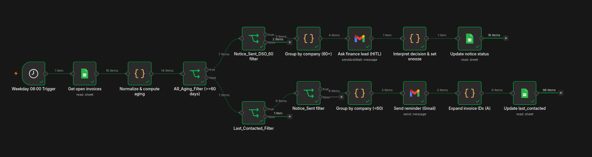
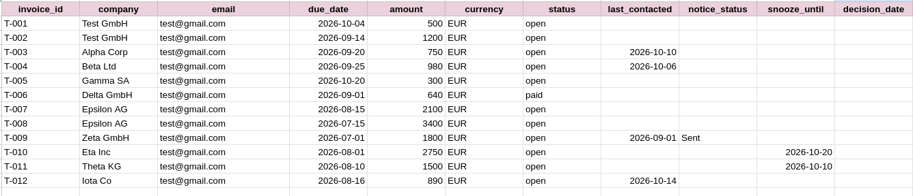

# Accounts Receivable Follow-up Automation (n8n)

An n8n workflow that automates accounts receivable follow-up in two tiers:

- **Routine reminders** for invoices less than 60 days overdue, sent automatically with a 7-day cooldown.
- **Human-in-the-loop escalation** for invoices 60+ days overdue, where a finance lead decides what happens next.

State lives in a single Google Sheet that acts as the source of truth between runs.



## How it works

The workflow runs Monday to Friday at 08:00 (Europe/Berlin). Days overdue are computed from `due_date` on every run, so the sheet never holds a stale aging value.

```
Schedule (Mon-Fri 08:00)
  -> Get open invoices (Google Sheets)
  -> Normalize & compute aging (drops paid/cancelled/void rows)
  -> AR_Aging_Filter (>= 60 days?)
       |
       |-- NO  (< 60 days)  -> Branch A: routine reminders
       |-- YES (>= 60 days) -> Branch B: escalation
```

### Branch A: routine reminders (< 60 days overdue)

1. **Last_Contacted_Filter**: keep invoices never contacted, or last contacted 7+ days ago (the cooldown that prevents spam).
2. **Notice_Sent filter**: drop anything already marked as formally noticed.
3. **Group by company**: one email per client, listing all of its overdue invoices with amounts and due dates.
4. **Send reminder (Gmail)**: sends the grouped email.
5. **Update last_contacted**: writes today's date back to every invoice in the email, matched on `invoice_id`.

### Branch B: escalation (>= 60 days overdue)

1. **Notice_Sent_DSO_60 filter**: keep invoices with no formal notice sent and not currently snoozed.
2. **Group by company**: one approval request per client.
3. **Ask finance lead (HITL)**: Gmail "Send and Wait for Response". The finance lead receives an email with a form and picks a decision:

   | Decision | Meaning | Effect on the sheet |
   |---|---|---|
   | **Sent** | Formal notice has gone out | `notice_status = Sent`; never flagged again |
   | **Delayed** | Client was granted more time | `snooze_until` = today + 14 days |
   | **Not processed** | Skip for now (dispute, credit hold) | `snooze_until` = today + 7 days |
   | *(no answer)* | Wait limit (20 h) expired | Snoozed 1 day, asked again at the next run |

4. **Update notice status**: writes the decision back per invoice, so the next run respects it instead of re-flagging.

### Design decisions

- **Single boundary:** one split at `days_overdue >= 60`, so no invoice at exactly 60 days falls between branches.
- **Snooze column:** "Delayed" and "Not processed" would otherwise reappear at the next 08:00 run.
- **Wait timeout:** the approval step cannot pile up unanswered executions.
- **Updates keyed on `invoice_id`:** grouping by company collapses rows, so invoice IDs are carried through and expanded again before each sheet update.
- **Paid invoices are ignored:** rows with status `paid`, `cancelled` or `void` are skipped.

## Google Sheet



Create a sheet with a tab (for example `AR Reminder Sheet`) and these headers in row 1, spelled exactly like this:

| Column | Description |
|---|---|
| `invoice_id` | **Unique** invoice ID (used to match rows on update) |
| `company` | Client name (used for grouping) |
| `email` | Billing contact email |
| `due_date` | Due date, `yyyy-mm-dd` (also accepts `dd.mm.yyyy` and `m/d/yyyy`) |
| `amount` | Invoice amount |
| `currency` | Currency code, e.g. `EUR` |
| `status` | `open`, or blank. `paid`, `cancelled` and `void` are ignored |
| `last_contacted` | Filled by the workflow (Branch A) |
| `notice_status` | Filled by the workflow (Branch B): `Sent`, `Delayed`, `Not processed`, `No response` |
| `snooze_until` | Filled by the workflow (Branch B) |
| `decision_date` | Filled by the workflow (Branch B) |

> **`invoice_id` must be unique.** The update steps match rows on this column and only change the **first** matching row. If the same ID appears twice, the second row is never updated and the first one may receive another invoice's data.

## Setup

Tested on self-hosted n8n 2.41.6.

### 1. Google Cloud project

1. Create a project in the [Google Cloud Console](https://console.cloud.google.com).
2. Under **APIs & Services -> Library**, enable the **Google Sheets API**, **Google Drive API** and **Gmail API**.
3. Under **OAuth consent screen**, choose **External**, fill in the app name and your email, and add your Google account as a **Test user**. Optionally click **Publish app** so tokens don't expire after 7 days (Google verification is not needed for personal use).
4. Under **Credentials -> Create credentials -> OAuth client ID**, choose **Web application**. Add the **OAuth Redirect URL** shown in the n8n credential window to **Authorized redirect URIs**.
5. Copy the Client ID and create a Client Secret (copy it immediately; it is not shown in full again).

### 2. n8n credentials

Create two credentials using the same Client ID and Secret:

- **Google Sheets OAuth2 API**: used by "Get open invoices", "Update last_contacted" and "Update notice status".
- **Gmail OAuth2 API**: used by "Send reminder (Gmail)" and "Ask finance lead (HITL)".

Click **Sign in with Google** in each. Do not copy the secret from another n8n credential: n8n masks it and the login fails with `invalid_client`.

### 3. Import and configure the workflow

1. In n8n, go to **Workflows -> Import from file** and select the workflow JSON.
2. In all three Google Sheets nodes, select your spreadsheet and tab from the dropdowns, and attach the Sheets credential.
3. Check the two write-back nodes, **Update last_contacted** and **Update notice status**. Each must have **Operation = Update Row**, **Column to match on = `invoice_id`** and mapping set to **Map Automatically**. On the canvas they should be labelled `update: sheet`; if one says `read: sheet`, it is reading instead of writing. The first node, **Get open invoices**, stays in read mode.
4. In both Gmail nodes, attach the Gmail credential.
5. In **Ask finance lead (HITL)**, set the **To** address to the finance lead.
6. For the approval link to work for someone other than you, n8n must be reachable from their browser. Set `WEBHOOK_URL` to your public HTTPS address. On `localhost` the link works only on the same machine.

### 4. Test, then activate

Follow the test scenarios below with test data and your own email addresses. When it behaves correctly, replace the test rows with real invoices, set the real finance lead address and switch the workflow to **Active**. The schedule trigger only fires while the workflow is active.

## Test scenarios

`test-data/ar_test_data.csv` contains 12 invoices that cover every branch. The dates are set relative to **2026-10-14**; if you run the test on another day, shift the `due_date` and `last_contacted` values by the same number of days.

Replace `yourname` in the `email` column with your own address (plus-addressing, such as `yourname+alpha@gmail.com`, still delivers to your inbox but keeps the companies separate). Import the file into your sheet with **File -> Import -> Replace current sheet**, then click **Execute workflow**.

| Invoice | Setup | Expected result |
|---|---|---|
| T-001, T-002 | Test GmbH, 10 and 30 days overdue, never contacted | One combined reminder listing both |
| T-003 | 24 days overdue, contacted 4 days ago | No email (7-day cooldown) |
| T-004 | 19 days overdue, contacted 8 days ago | Reminder sent |
| T-005 | Due in 6 days | Ignored (not overdue) |
| T-006 | Status `paid` | Ignored |
| T-012 | Exactly 59 days overdue | Reminder (last day of the routine tier) |
| T-007, T-008 | Epsilon AG, exactly 60 and 91 days overdue | One approval email for both (tests the 60-day boundary) |
| T-009 | 105 days overdue, `notice_status = Sent` | Ignored in both branches |
| T-010 | 74 days overdue, snoozed until 2026-10-20 | Ignored (snoozed) |
| T-011 | 65 days overdue, snooze expired 2026-10-10 | Approval email |

### Expected result of the first run

- **3 reminder emails:** Test GmbH (T-001 + T-002), Beta Ltd (T-004), Iota Co (T-012).
- **2 approval emails:** Epsilon AG (T-007 + T-008), Theta KG (T-011).
- `last_contacted` set to today for T-001, T-002, T-004 and T-012 only.

### Testing the approval decisions

1. Answer Epsilon AG with **Delayed**: T-007 and T-008 get `snooze_until` = today + 14 days.
2. Answer Theta KG with **Not processed**: T-011 gets `snooze_until` = today + 7 days.
3. Run the workflow again immediately. No emails should be sent, which confirms the cooldown and snooze logic.
4. Clear `last_contacted`, `notice_status`, `snooze_until` and `decision_date` to reset between tests.

### Testing the timeout

Temporarily set the wait limit in **Ask finance lead (HITL)** to 2 minutes, leave an approval email unanswered, and check that the invoice is written back as `No response` with a 1-day snooze.

## Known limitations

- Duplicate `invoice_id` values break the write-back (see the note in the sheet section). Keep IDs unique, and clear old test rows before importing the test data.
- The "no response" path depends on how n8n resumes an execution after the wait limit; verify it in your n8n version using the timeout test above.
- Mapping decisions back to invoices relies on the order of the grouped items, so don't insert nodes between "Group by company (60+)" and "Interpret decision & set snooze" that change item order.
- The approval step asks the finance lead only. The workflow does not send a formal notice to the client itself.
- Amounts are treated as plain numbers; mixed currencies are listed per invoice but not converted.

## Repository layout

```
.
├── README.md
├── ar-followup-workflow.json
├── test-data/
│   └── ar_test_data.csv
└── docs/
    ├── canvas.png
    └── sheet.png
```

## License

MIT
